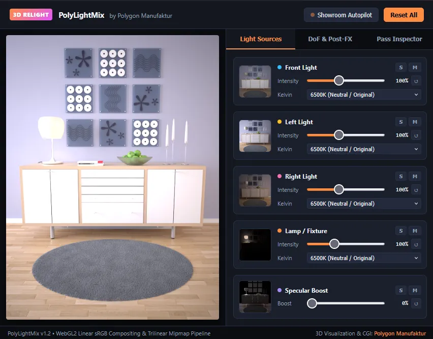

# PolyLightMix – Interactive WebGL2 3D Relight & Post-FX Compositor

[**👉 Launch Interactive Live Demo: https://www.polygonmanufaktur.de/polylightmix/**](https://www.polygonmanufaktur.de/polylightmix/)

**PolyLightMix** is a lightweight, zero-dependency, open-source WebGL2 relighting and post-processing engine built for 3D artists, architectural visualizers, and digital agencies. Running entirely client-side in any modern web browser, it translates studio relighting pipelines—familiar from industry render engines like Indigo Renderer, Corona Renderer, and V-Ray LightMix—into a hardware-accelerated web experience.

Traditional architectural visualization workflows lock illumination into static 2D images. When clients or stakeholders request lighting adjustments, artists typically face time-consuming re-renders or heavy multi-layer PSD files. PolyLightMix removes this bottleneck by enabling real-time linear light pass compositing directly inside the browser viewport.

### Core Capabilities

* **Exact IEC 61966-2-1 Linear sRGB ADD Blending:** Converts multi-pass lighting layers (`Front`, `Left`, `Right`, `Lamp`, and `Specular Boost`) into linear color space, sums their radiant energy without midtone shifts, and outputs calibrated sRGB.
* **Physical Kelvin Color Tuning:** Dynamically adjusts color temperatures per light source from warm candle/filament tones (2000K) to neutral daylight (6500K) and cool overcast sky (9000K).
* **Interactive Click-to-Focus Depth of Field (DoF):** Samples real pixel depth values directly from the 3D Z-depth pass on click and renders customizable polygonal bokeh shapes (**Circular, 5-Blade Pentagon, 6-Blade Hexagon, 7-Blade Heptagon, and 8-Blade Octagon**).
* **Cinematic Post-FX & Studio AOV Inspector:** Includes multi-tap highlight bloom, exposure control, optional ACES Filmic tonemapping rolloff, and a real-time pass inspector for *Surface Normals*, *Albedo*, *Material ID*, and *Z-Depth*.
* **Hardware Trilinear Mipmap Anti-Aliasing:** Uses WebGL2 mipmap generation (`LINEAR_MIPMAP_LINEAR`) and anisotropic filtering for crisp, alias-free downscaling across any viewport resolution.
* **Showroom Autopilot:** Integrated self-running showcase mode that animates lighting moods and UI sliders in real-time until the user interacts.

---

### Live Implementation & Credits

Developed and maintained by [**Polygon Manufaktur**](https://www.polygonmanufaktur.de) – Studio for High-End 3D Architectural Visualization, Product CGI & Animation in Hamburg, Germany.

* **Live Tool & Interactive Demo:** [https://www.polygonmanufaktur.de/polylightmix/](https://www.polygonmanufaktur.de/polylightmix/)
* **Studio Portfolio:** [https://www.polygonmanufaktur.de](https://www.polygonmanufaktur.de)
